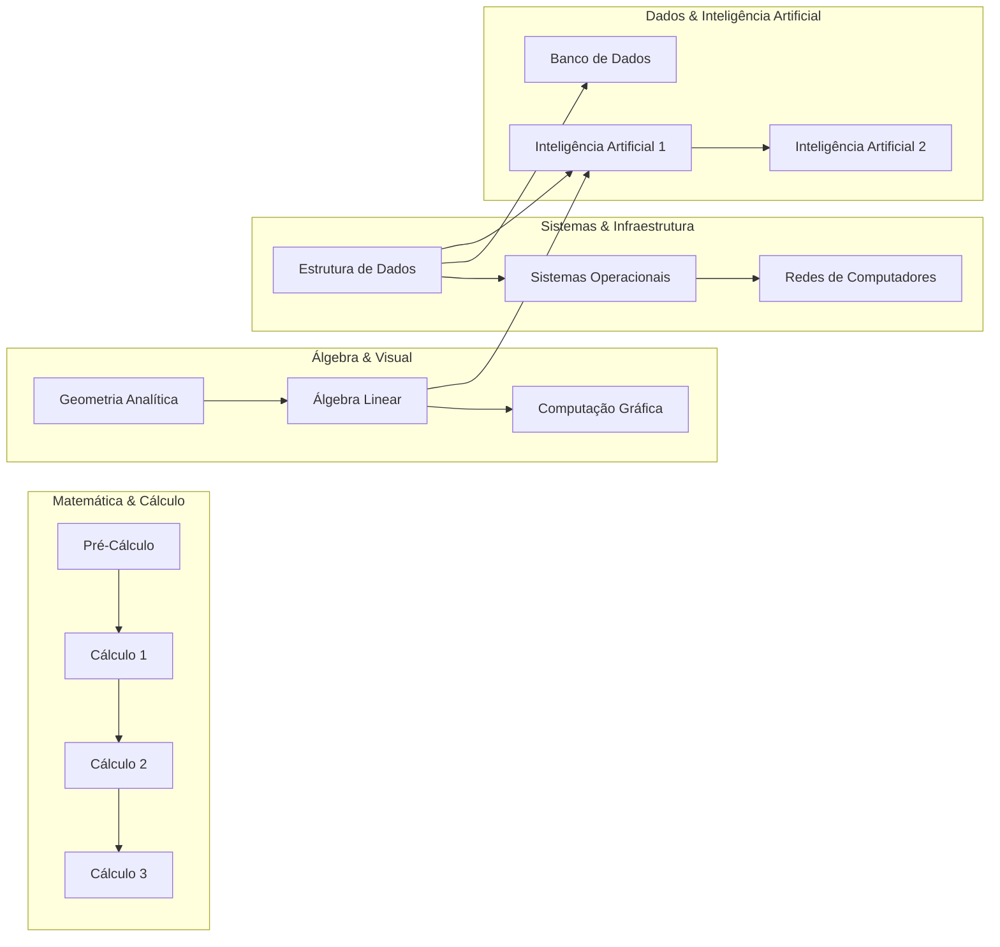

# Sistema de Dependências de Disciplinas - Teoria dos Grafos

Estrutura computacional orientada a objetos para representação e análise de matrizes curriculares acadêmicas utilizando **Grafos Direcionados (Dígrafos)**, algoritmos de **Busca em Profundidade (DFS)**, **Detecção de Ciclos com 3 Cores**, **Ordenação Topológica (Algoritmo de Kahn)** e persistência em banco relacional **SQLite** e arquivos **CSV**.

---

## 🎯 Visão Geral da Matriz Curricular

O grafo modela as relações de precedência acadêmica do curso de Ciência da Computação, onde cada aresta direcionada indica:
$$u \longrightarrow v \iff \text{Disciplina } u \text{ é pré-requisito de } v$$



---

## 📁 Estrutura do Repositório

```text
teoria-dos-grafos/
├── README.md                      # Documentação técnica do código
├── main.py                        # Executável de demonstração e menu interativo
├── data/
│   ├── disciplinas.csv            # Catálogo tabular de matérias
│   ├── dependencias.csv           # Relação PreRequisito -> Disciplina
│   └── universidade.db            # Base de dados SQLite
├── src/
│   ├── models/
│   │   ├── grafo.py               # Classes Vertice e GrafoDirecionado (DFS, Ciclos, TopoSort)
│   │   └── disciplina.py          # Dataclasses de DisciplinaModel e AlunoModel
│   ├── database/
│   │   ├── schema.sql             # Esquema DDL do SQLite com integridade referencial
│   │   ├── db_manager.py          # Gerenciador de conexão (contextmanager) e queries
│   │   └── seed.py                # Script de povoamento inicial e geração de CSVs
│   └── services/
│       └── curriculo_service.py   # Carregador do grafo a partir do SQLite e CSVs
└── tests/
    ├── test_grafo.py              # Testes unitários do dígrafo e dos algoritmos
    └── test_database.py           # Testes de integração do SQLite e dos casos de teste
```

---

## 🧠 Algoritmos Implementados

### 1. Consulta de Impacto com Busca DFS (Caso de Teste 1)
- **Método**: `grafo.consultar_impacto(id_vertice)` e `grafo.buscar_caminho_dfs(origem, destino)`
- **Objetivo**: Descobrir todo o fecho transitivo de matérias liberadas direta ou indiretamente pela conclusão de uma disciplina.
- **Exemplo**: O impacto de **Estrutura de Dados (ED)** retorna:
  $$\text{Impacto(ED)} = \{\text{Banco de Dados, Sistemas Operacionais, Redes de Computadores, IA 1, IA 2}\}$$

### 2. Detecção de Ciclos com DFS de 3 Cores (Caso de Teste 2)
- **Métodos**: `grafo.detectar_ciclo()`, `grafo.validar_adicao_aresta(u, v)` e `grafo.adicionar_aresta_segura(u, v)`
- **Algoritmo**: Utiliza coloração de estados da DFS:
  - **BRANCO (0)**: Vértice não visitado.
  - **CINZA (1)**: Vértice em processamento na pilha de recursão.
  - **PRETO (2)**: Vértice totalmente explorado.
- **Detecção e Caminho Fechado**: Ao encontrar um vértice vizinho no estado **CINZA**, identifica a *back-edge* (aresta de retorno) e reconstrói o caminho fechado exato.
- **Exemplo**: Ao simular a dependência circular $\text{IA2} \rightarrow \text{ED}$, o sistema alerta e recupera o ciclo:
  $$\text{ED} \longrightarrow \text{IA1} \longrightarrow \text{IA2} \longrightarrow \text{ED}$$

### 3. Ordenação Topológica da Grade (Algoritmo de Kahn)
- **Métodos**: `grafo.ordenacao_topologica()` e `grafo.ordenacao_topologica_por_niveis()`
- **Objetivo**: Determinar a sequência linear viável para cursar as matérias respeitando todos os pré-requisitos, além de agrupar as disciplinas nas camadas topológicas mínimas de semestres (caminho crítico de 4 semestres para formatura).

---

## 🚀 Como Executar

### Pré-requisitos
- **Python 3.10+** (utiliza estritamente a biblioteca padrão: `sqlite3`, `unittest`, `dataclasses`).

### 1. Demonstração Automática Completa (Casos 1 e 2 + Ordenação)
```bash
python main.py --demo
```

### 2. Menu Interativo no Terminal
```bash
python main.py
```

Opções disponíveis no menu:
- `[1]` Exibir Grafo Completo (Vértices, Arestas, Graus e Adjacências)
- `[2]` Exibir Dados do SQLite (Alunos e Histórico)
- `[3]` Consultar Adjacências e Impacto de uma Disciplina
- `[4]` Adicionar Vértice Manualmente ao Grafo
- `[5]` Adicionar Aresta Manualmente ao Grafo (com Validação Preventiva de Ciclos)
- `[6]` Reinicializar Banco SQLite e CSVs (Seed)
- `[7]` Consultar Impacto Completo (Busca DFS - Caso de Teste 1)
- `[8]` Verificar Ciclos no Grafo / Simular Falha (Caso de Teste 2)
- `[9]` Gerar Ordenação Topológica da Grade Curricular
- `[0]` Sair

### 3. Execução dos Testes Automatizados
```bash
python -m unittest discover -s tests -v
```

### 4. Reinicialização da Base de Dados (Seed)
```bash
python src/database/seed.py
```

---

## 🧪 Casos de Teste Validados

### Caso de Teste 1: Consulta de Sucesso
- **Entrada**: Consultar impacto de `Estrutura de Dados` (`ED`).
- **Saída**:
  - `Banco de Dados` (Caminho: `ED -> BD`)
  - `Sistemas Operacionais` (Caminho: `ED -> SO`)
  - `Redes de Computadores` (Caminho: `ED -> SO -> Redes`)
  - `Inteligência Artificial 1` (Caminho: `ED -> IA1`)
  - `Inteligência Artificial 2` (Caminho: `ED -> IA1 -> IA2`)

### Caso de Teste 2: Identificação de Falha (Ciclo)
- **Entrada**: Tentativa de adicionar aresta `IA2 -> ED`.
- **Saída**:
  - `[ALERTA DE ERRO: DEPENDENCIA CIRCULAR DETECTADA]`
  - Caminho fechado: `ED -> IA1 -> IA2 -> ED`
