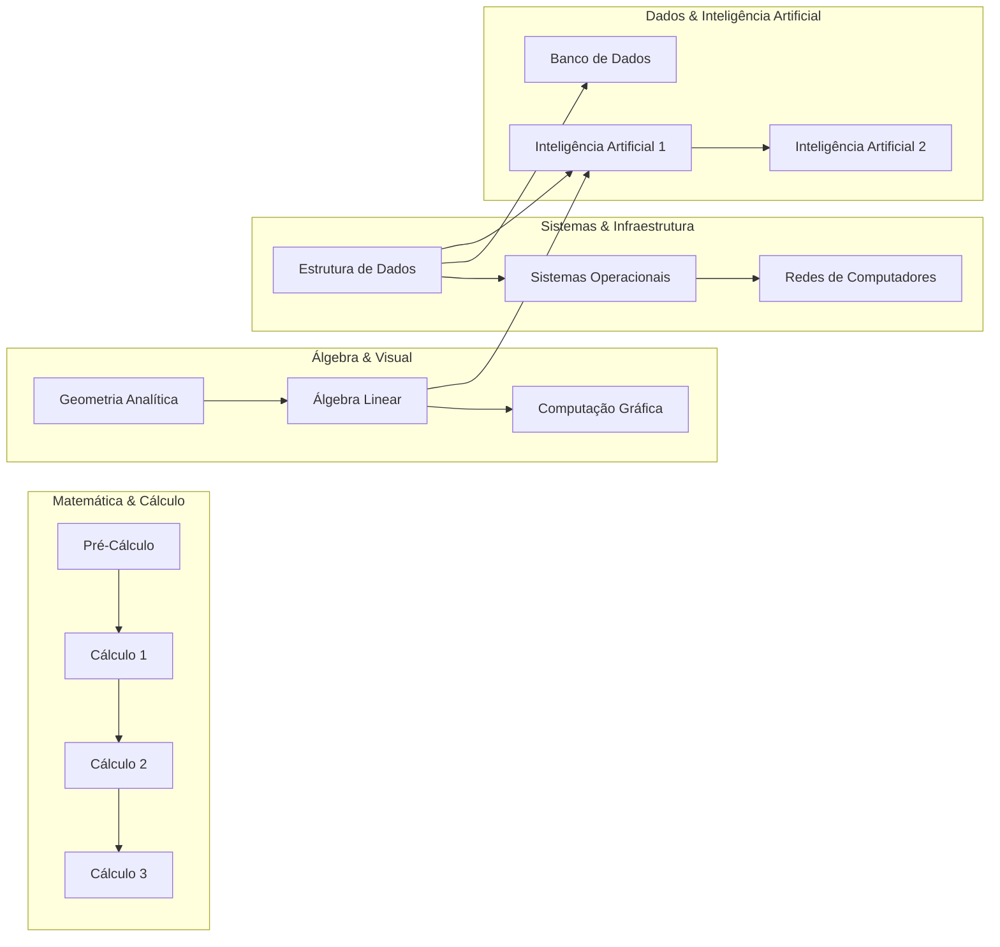

# Sistema de Dependências de Disciplinas - Teoria dos Grafos

Estrutura computacional orientada a objetos para representação e análise de matrizes curriculares acadêmicas utilizando **Grafos Direcionados (Dígrafos)**, algoritmos de **Busca em Profundidade (DFS)**, **Detecção de Ciclos com 3 Cores**, **Ordenação Topológica (Algoritmo de Kahn)** e persistência em banco relacional **SQLite** e arquivos **CSV**.

---

## 🎯 Visão Geral da Matriz Curricular

O grafo modela as relações de precedência acadêmica do curso de Ciência da Computação, onde cada aresta direcionada indica:
$$u \longrightarrow v \iff \text{Disciplina } u \text{ é pré-requisito de } v$$



---

## 📁 Estrutura do Repositório

```text
teoria-dos-grafos/
├── README.md                      # Documentação técnica do código
├── docs/CENARIO_DE_TESTE.md       # Roteiro de teste pela interface web
├── main.py                        # Executável de demonstração e menu interativo
├── data/
│   ├── disciplinas.csv            # Catálogo tabular de matérias
│   ├── dependencias.csv           # Relação PreRequisito -> Disciplina
│   └── universidade.db            # Base de dados SQLite
├── src/
│   ├── models/
│   │   ├── grafo.py               # Classes Vertice e GrafoDirecionado (DFS, Ciclos, TopoSort)
│   │   └── disciplina.py          # Dataclasses de DisciplinaModel e AlunoModel
│   ├── database/
│   │   ├── schema.sql             # Esquema DDL do SQLite com integridade referencial
│   │   ├── db_manager.py          # Gerenciador de conexão (contextmanager) e queries
│   │   └── seed.py                # Script de povoamento inicial e geração de CSVs
│   ├── services/
│   │   └── curriculo_service.py   # Carregador do grafo a partir do SQLite e CSVs
│   └── api/
│       └── server.py              # API HTTP (http.server) consumida pelo frontend
├── frontend/                      # Interface web (React + TypeScript + Vite + Tailwind)
│   └── src/
│       ├── App.tsx                # Navegação e carregamento dos dados
│       ├── api.ts / types.ts      # Cliente HTTP e formatos das respostas
│       ├── layout.ts              # Posição dos vértices (coluna = período)
│       ├── pages/                 # Abas Grafo, Disciplinas e Alunos
│       └── components/            # Canvas SVG do grafo, formulários e componentes de UI
└── tests/
    ├── test_grafo.py              # Testes unitários do dígrafo e dos algoritmos
    ├── test_database.py           # Testes de integração do SQLite (banco temporário)
    └── test_api.py                # Testes de integração da API HTTP
```

---

## 🧠 Algoritmos Implementados

### 1. Consulta de Impacto com Busca DFS (Caso de Teste 1)
- **Método**: `grafo.consultar_impacto(id_vertice)` e `grafo.buscar_caminho_dfs(origem, destino)`
- **Objetivo**: Descobrir todo o fecho transitivo de matérias liberadas direta ou indiretamente pela conclusão de uma disciplina.
- **Exemplo**: O impacto de **Estrutura de Dados (ED)** retorna:
  $$\text{Impacto(ED)} = \{\text{Banco de Dados, Sistemas Operacionais, Redes de Computadores, IA 1, IA 2}\}$$

### 2. Detecção de Ciclos com DFS de 3 Cores (Caso de Teste 2)
- **Métodos**: `grafo.detectar_ciclo(passos=...)`, `grafo.validar_adicao_aresta(u, v)` e `grafo.adicionar_aresta_segura(u, v)`
- **Algoritmo**: Utiliza coloração de estados da DFS:
  - **BRANCO (0)**: Vértice não visitado.
  - **CINZA (1)**: Vértice em processamento na pilha de recursão.
  - **PRETO (2)**: Vértice totalmente explorado.
- **Detecção e Caminho Fechado**: Ao encontrar um vértice vizinho no estado **CINZA**, identifica a *back-edge* (aresta de retorno) e reconstrói o caminho fechado exato. O parâmetro opcional `passos` registra cada transição de cor; é o que o frontend anima.
- **Validação preventiva**: `validar_adicao_aresta(u, v, passos=...)` insere a aresta temporariamente, roda a DFS de 3 cores e restaura o grafo. Os passos registrados são os que a interface anima no Caso de Teste 2. Se a DFS esbarrar num ciclo antigo que não passa por $u \to v$, a decisão usa a busca de caminho $v \leadsto u$.
- **Exemplo**: Ao simular a dependência circular $\text{IA2} \rightarrow \text{ED}$, o sistema alerta e recupera o ciclo:
  $$\text{ED} \longrightarrow \text{IA1} \longrightarrow \text{IA2} \longrightarrow \text{ED}$$

### 3. Ordenação Topológica da Grade (Algoritmo de Kahn)
- **Métodos**: `grafo.ordenacao_topologica()` e `grafo.ordenacao_topologica_por_niveis()`
- **Objetivo**: Determinar a sequência linear viável para cursar as matérias respeitando todos os pré-requisitos, além de agrupar as disciplinas nas camadas topológicas mínimas de semestres (caminho crítico de 4 semestres para formatura).

---

## 🚀 Como Executar

### Pré-requisitos
- **Python 3.10+** (utiliza estritamente a biblioteca padrão: `sqlite3`, `unittest`, `dataclasses`).

### 1. Demonstração Automática Completa (Casos 1 e 2 + Ordenação)
```bash
python main.py --demo
```

### 2. Menu Interativo no Terminal
```bash
python main.py
```

Opções disponíveis no menu:
- `[1]` Exibir Grafo Completo (Vértices, Arestas, Graus e Adjacências)
- `[2]` Exibir Dados do SQLite (Alunos e Histórico)
- `[3]` Consultar Adjacências e Impacto de uma Disciplina
- `[4]` Adicionar Vértice Manualmente ao Grafo
- `[5]` Adicionar Aresta Manualmente ao Grafo (com Validação Preventiva de Ciclos)
- `[6]` Reinicializar Banco SQLite e CSVs (Seed)
- `[7]` Consultar Impacto Completo (Busca DFS - Caso de Teste 1)
- `[8]` Verificar Ciclos no Grafo / Simular Falha (Caso de Teste 2)
- `[9]` Gerar Ordenação Topológica da Grade Curricular
- `[0]` Sair

### 3. Interface Web (API + Frontend)

A interface não reimplementa nenhum algoritmo: tudo o que ela mostra vem da API, que chama `src/models/grafo.py`. A API carrega o grafo do SQLite uma vez e mantém a lista de adjacência em memória; **toda pesquisa roda só sobre essa estrutura**. O SQLite é usado apenas para gravar alterações do cadastro, e depois de cada gravação o grafo em memória é recarregado.

Requer **Node.js 20+** só para compilar o frontend.

```bash
# Uma vez: instalar dependências e compilar o frontend
cd frontend && npm install && npm run build && cd ..

# Sobe a API e serve a interface em http://127.0.0.1:8000
python main.py --api
```

Para desenvolver o frontend com recarga automática, deixe `python main.py --api` rodando e, em outro terminal, `cd frontend && npm run dev` (o Vite encaminha `/api` para a porta 8000).

**Abas da interface**
- **Grafo**: visualização do dígrafo com três modos. *Impacto* pesquisa uma disciplina (sigla, código ou nome) e mostra as impactadas na ordem da DFS (Caso de Teste 1). *Ciclos* testa uma nova dependência com a DFS de 3 cores, animada passo a passo, e só permite gravá-la se não houver ciclo (Caso de Teste 2). *Ordem* mostra a ordenação topológica de Kahn, a sequência por DFS e os semestres.
- **Disciplinas**: lista por período e detalhe da disciplina, com criar, editar, excluir e gerenciar os pré-requisitos dela (novos pré-requisitos passam pela validação de ciclo).
- **Alunos**: lista e detalhe do aluno, com criar, editar, excluir, progresso no curso e histórico (registrar, editar e remover disciplinas cursadas). Para registrar uma disciplina como cursando ou aprovada, os pré-requisitos dela precisam estar aprovados.

**Rotas da API**

| Método | Rota | O que faz |
|---|---|---|
| GET | `/api/grafo` | Vértices, arestas, graus e se o grafo é DAG |
| GET | `/api/consulta?termo=...` | Caso de Teste 1: impacto por DFS, Γ⁻, fator de bloqueio e caminhos |
| POST | `/api/prerequisitos/validar` | Caso de Teste 2: DFS de 3 cores com a aresta proposta (não grava) |
| GET | `/api/ciclos` | DFS de 3 cores na grade atual, com os passos |
| GET | `/api/ordenacao` | Kahn, DFS pós-ordem e níveis |
| POST · DELETE | `/api/prerequisitos[/{u}/{v}]` | Grava (após validar ciclo) ou remove pré-requisito |
| POST · PUT · DELETE | `/api/disciplinas[/{id}]` | Cadastro de disciplinas |
| GET | `/api/disciplinas/{id}/remocao` | O que será apagado junto com a disciplina |
| GET · POST · PUT · DELETE | `/api/alunos[/{id}]` | Cadastro de alunos (com histórico e progresso) |
| POST | `/api/alunos/{id}/matriculas` | Registra disciplina no histórico |
| PUT · DELETE | `/api/matriculas/{id}` | Edita ou remove registro do histórico |
| GET | `/api/cursos` | Cursos cadastrados |
| POST | `/api/restaurar` | Volta o banco aos dados do seed |

O roteiro completo para testar cada etapa pela interface está em [`docs/CENARIO_DE_TESTE.md`](docs/CENARIO_DE_TESTE.md).

### 4. Execução dos Testes Automatizados
```bash
python -m unittest discover -s tests -v
```
Os testes usam um banco SQLite temporário e não alteram `data/`.

### 5. Reinicialização da Base de Dados (Seed)
```bash
python src/database/seed.py
```

---

## 🧪 Casos de Teste Validados

### Caso de Teste 1: Consulta de Sucesso
- **Entrada**: Consultar impacto de `Estrutura de Dados` (`ED`).
- **Saída**:
  - `Banco de Dados` (Caminho: `ED -> BD`)
  - `Sistemas Operacionais` (Caminho: `ED -> SO`)
  - `Redes de Computadores` (Caminho: `ED -> SO -> Redes`)
  - `Inteligência Artificial 1` (Caminho: `ED -> IA1`)
  - `Inteligência Artificial 2` (Caminho: `ED -> IA1 -> IA2`)

### Caso de Teste 2: Identificação de Falha (Ciclo)
- **Entrada**: Tentativa de adicionar aresta `IA2 -> ED`.
- **Saída**:
  - `[ALERTA DE ERRO: DEPENDENCIA CIRCULAR DETECTADA]`
  - Caminho fechado: `ED -> IA1 -> IA2 -> ED`
